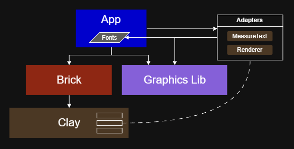

# Brick

### Render-agnostic, header-only UI Component Library for Clay

Brick is a UI component library extending the UI layout library [Clay](https://github.com/nicbarker/clay). Brick separates content, layout, styles, and events for a flexible way to build interactive app user interfaces. It extends Clay by adding a thin state layer that keeps track of component states and exposes a flexible way to handle UI events and component styles. 

## Features

- Library of UI elements, components, and containers
- Interchangeability with [Clay](https://github.com/nicbarker/clay)
- Basic UI state management
- UI events with flexible handling
- Seperation of content, layout, and styles
- Default and customizable styles
- Small STB-style header-only library for C99, C++20 and above
- Render agnostic

Roadmap:
- Reactive layouts adapt to window resizing
- Default renderers for multiple graphics libs
- Unified style effects with shaders, i.e. drop shadows and gradients

For a detailed explanation see [Overview](#overview-1).

## Contents

#### [Why Brick?](#why-brick-1)
#### [Setup](#setup-1)
#### [Quick Start](#quick-start-1)
#### [Examples](#examples-1)
#### [Objectives](#objectives-1)
#### [Technical Overview](#technical-overview-1)
#### [Components](#components-1)
#### [Development](#development-1)

---

## Why Brick?

Brick is a set of UI components that handle layout, styles, UI events, and accomplishes this in relatively few lines of code without sacrificing customizability, portability, and performance. Brick works well for smaller interactive apps that need a quick solution for a navigation system, a set of options, main menu screen, etc. Brick is NOT for UI heavy applications that have hundreds of buttons or pages like websites or command panels.

## Setup

### CMake
In CMakeLists.txt add:
```CMake
  FetchContent_Declare(brick GIT_REPOSITORY ... head ...)
  FetchContent_MakeAvailable(brick)
  target_link_libraries(my_app PRIVATE Brick::Brick)
```
This should make brick.h available, as well as clay.h, and the clay renderers.

### Manual Install
- Copy Clay - go to the [Clay repo](https://github.com/nicbarker/clay), copy clay.h into your includes folder.
- Copy Brick - copy brick.h from this repo and add it to your includes folder.

### Usage
In exactly one implementation file, import brick and define the implementation flag:
```C
#define BRICK_IMPLEMENTATION
#include "brick.h"         
```

NOTE: do not define BRICK_IMPLEMENTATION in more than one file, you will get ODR errors<br>
NOTE: You can import brick.h (without defining BRICK_IMPLEMENTATION) in as many other files as needed.<br>
NOTE: You can import clay.h into any other files, including the same file as brick.h import, but DO NOT define CLAY_IMPLEMENTATION.

## Quick Start
Brick requires [Clay](https://github.com/nicbarker/clay), and exposes some of the Clay interface. Make sure you have a good idea of what it does.

### Quick Start Overview
Make sure Clay is in your include path. Import Brick and define BRICK_IMPLEMENTION in EXACTLY ONE FILE.
Then initialize with Brick_Initialize, and then create any components. These functions are not to be called in the update loop!

In the update loop call the UpdateEvents passing in the input data. Then build the component Layout using component IDs.
Finally take the render commands from the EndLayout function and pass it into the renderer function.

This overview is outlined in the seven steps below.

### Main Steps
1. Import Brick, and define the implementation flag.
```C
#define BRICK_IMPLEMENTATION
#include "brick.h"         
```

2. Import the Renderer, in this case we're using renderers provided by Clay.
```C
#include "renderers/raylib/clay_renderer_raylib.c"
```

3. Initialize and create components. DO NOT call these in a loop!
```C
// Initialize Brick with initial screen dimensions, the MeasureText function,
// and an array of fonts that will be referenced in the MeasureText function
Brick_Initialize(SCREEN_WIDTH, SCREEN_HEIGHT, Raylib_MeasureText, fonts);

// Create any components, i.e. file menu button
Brick_ComponentId file_ButtonId = Brick_CreateLabelButton("File");
```

4. Update events in the main loop of the app (this highly depends on graphics lib input handling API)
```C
Brick_PointerData pointerData = (Brick_PointerData){ 
    .x = GetMouseX(), 
    .y = GetMouseY(), 
    .scrollX = mouseWheel.x, 
    .scrollY = mouseWheel.y, 
    .pressed = isPressed, 
    .released = isReleased
};
// Update events with pointer data and delta time
Brick_UpdateEvents(pointerData, GetFrameTime());
```

5. Build layout
```C
// Open the root layout
Brick_BeginLayout();
	// Layout any UI components, elements and containers here
	// by passing in the saved component ID, i.e. the file menu button.
	Brick_LayoutLabelButton(file_ButtonId);
// Close the root layout AND save the renderCommands array from Clay
Clay_RenderCommandArray renderCommands = Brick_EndLayout();
```

6. Render using one of Clay's default renderers, or a custom one
```C
// Use the returned renderCommands array from the closing layout and the fonts array,
// NOTE: this is a custom function and can have any parameters, renderCommands just need to be rendered.
Clay_Raylib_Render(renderCommands, fonts);
```

7. Cleanup - Call Brick_Destroy() and any other relevant functions for cleanup (Clay_Raylib_Close comes from Clay renderers)
```C
// This cleans up the Clay arena
Brick_Destroy();
// If using the default Raylib renderer from Clay's renderer,
// this function should be called to cleanup the temp string buffer.
Clay_Raylib_Close();
```

## Examples (Under Construction)

## Objectives
Brick extends Clay, a versatile UI layout library that provides an inline-style interface for creating any type of UI element. Clay's inline style API adds up quickly with relatively simple UIs taking thousands of lines of code. This also means the content (button labels, text, images, etc.) is in the same place as the styles, and the layout structure. 

<quote>Brick aims to add UI components as primitive building blocks that can be combined in many ways to build any UI, and separates content, styles, and layout, while retaining interoperability with Clay for maximum flexibility.</quote>

Brick objectives include:
- adding UI state on top of Clay
- adding component events and a flexible way of handling them
- separating content, layout, and styles
- retaining usage of Clay alongside Brick
- responsive styles that adjust to window resizing
- global style configuration that can be overridden at different levels
- quick setup and quick start with reasonable defaults
- remaining render agnostic while providing default renderers and remaining compatible with Clay default renderers

## Technical Overview (Under Construction)


## Components

### Text

A simple text element. It can be created and used in the layout with an ID, or just using the inline function:

```C
Brick_ElementId Brick_CreateText(const char* string);
Brick_ElementId Brick_CreateTextEx(const char* string, uint16_t fontId, uint16_t fontSize);

void Brick_LayoutText(Brick_ElementId textId);

void Brick_InlineText(const char* string);
void Brick_InlineTextEx(const char* string, uint16_t fontId, uint16_t fontSize);
```

### Image

An image element depends on the whatever data the renderer expects to display pixels on the screen. It could be an image format or a texture or something else. This data is passed through in the Clay_RenderCommand.

```C
Brick_ElementId Brick_CreateImage(float width, float height, void* imageData);

void Brick_LayoutImage(Brick_ElementId imageId);
```

### Label

A text element in a box. Labels are the simplest components that enclose text elements in a box element that contains padding, alignment and other properties.

```C
Brick_ComponentId Brick_CreateLabel(const char* string);
Brick_ComponentId Brick_CreateLabelEx(const char* string, uint16_t fontId, uint16_t fontSize);

void Brick_LayoutLabel(Brick_ComponentId labelId);
```

### Button

The humble button. It is essentially a label with a background plus interactivity. It tracks its different states like hover, pressed, released that an be queried for UI functionality.

```C
Brick_ComponentId Brick_CreateButton(const char* text);
Brick_ComponentId Brick_CreateButtonEx(const char* text, uint16_t fontId, uint16_t fontSize);

void Brick_LayoutButton(Brick_ComponentId buttonId);
```

### Label Button

A label with button interactivity. Labels do not have a background like buttons do. Label buttons act like buttons while remaining texts in a box.

```C
Brick_ComponentId Brick_CreateLabelButton(const char* text);

void Brick_LayoutLabelButton(Brick_ComponentId buttonId);
```

### Image Button

An image with button interactivity. Like label-buttons, image-buttons are images that are also interactive buttons.

```C
Brick_ComponentId Brick_CreateImageButton(float width, float height, void* imageData);

void Brick_LayoutImageButton(Brick_ComponentId buttonId);
```

### Label Group

A group of labels. Create a number of labels, then use an array of label IDs to group them.

```C
Brick_ComponentId Brick_CreateLabel(const char* string);
Brick_ComponentId labelIds[3] = { labelId1, labelId2, labelId3 };
Brick_ComponentId Brick_CreateGroup(const Brick_ComponentId* labelIds, int32_t groupSize);

void Brick_LayoutGroup(Brick_ComponentId labelGroupId);
```

### Button Group

A group of buttons. Create a number of buttons, then use an array of button IDs to group them.

```C
Brick_ComponentId Brick_CreateButton(const char* text);
Brick_ComponentId buttonIds[3] = { buttonId1, buttonId2, buttonId3 };
Brick_ComponentId Brick_CreateGroup(const Brick_ComponentId* buttonIds, int32_t groupSize);

void Brick_LayoutGroup(Brick_ComponentId buttonGroupId);
```

### Scroll Box

A container that scrolls vertically. Create the container first, then use Begin and End to enclose the content that will be scrolled:

```C
Brick_ContainerId Brick_CreateScrollBox(void);

void Brick_BeginScrollBox(void);
// scroll box contents
void Brick_EndScrollBox(void);
```

## Development (Under Construction)

Build (developer):
  cmake -B build (default) 
  --OR--
  cmake -B build -S . -G "MinGW Makefiles" (MSYS2 aka MinGW aka GCC on Windows)
  
  cmake --build build
  ctest --test-dir build --output-on-failure
 
Build for Web:
emcmake cmake -B build-web -S . -G "MinGW Makefiles" -DPLATFORM=Web

Install:
  cmake -B build -DCMAKE_INSTALL_PREFIX=/usr/local
  cmake --build build
  cmake --install build

Install for Web:
cmake --build build-web
cmake --install build-web --component Runtime